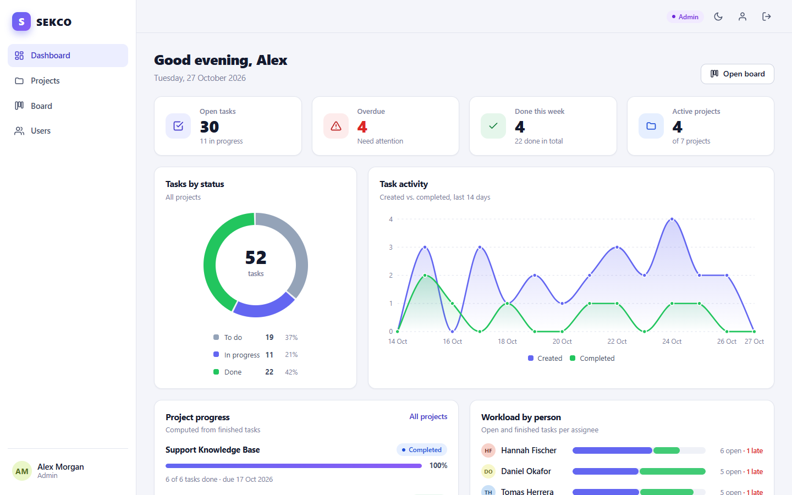
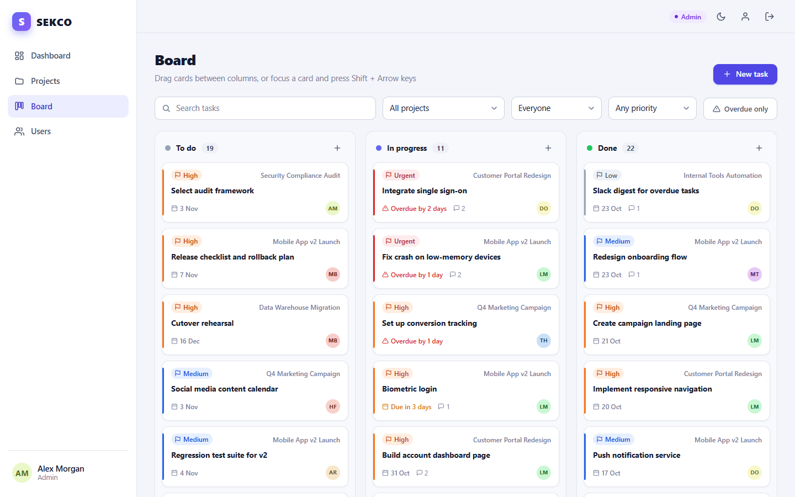
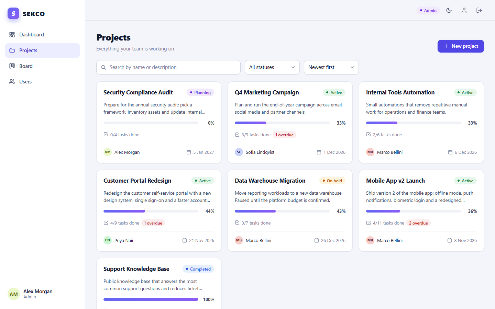
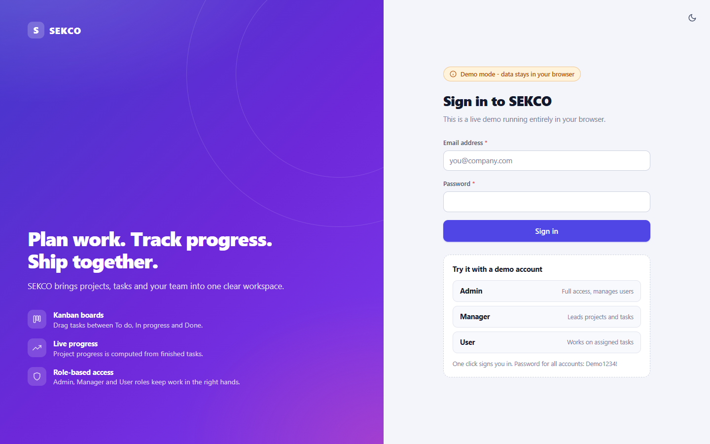

# SEKCO - Project & Task Management

SEKCO is a project and task management web application with role-based access, a drag-and-drop Kanban board, a live analytics dashboard and a full REST API. It is built with **Node.js, Express and MySQL** on the back end and a framework-free **ES-module** front end.

**[Open the live demo](https://vaas125.github.io/sekco-business-automation/)** - runs entirely in your browser (data is stored in `localStorage`; use the one-click demo accounts on the login screen).



| Kanban board | Projects |
| --- | --- |
|  |  |



## Features

**Work management**
- Projects with manager, status, start/end dates and **progress computed automatically** from finished tasks
- Tasks with priority, status, assignee, due date, `completed_at` timestamp and **comments**
- **Kanban board** (To do / In progress / Done) with HTML5 drag and drop, keyboard moves (`Shift` + arrow keys) and move buttons for touch devices
- Activity feed (who did what, when) globally and per project
- **Dashboard**: KPI cards, tasks by status (donut chart), created vs. completed over 14 days (SVG line chart), per-project progress, workload per person, overdue tasks, "my tasks" and recent activity

**Accounts and security**
- Registration is disabled: administrators create accounts
- JWT authentication with roles **Admin**, **Manager** and **User** (the user is re-loaded from the database on every request, so deactivation and role changes apply immediately)
- Admin user management: create, edit, deactivate/activate, reset password (generated temporary password or a chosen one)
- Profile page with password change; passwords are hashed with bcrypt
- Input validation with [zod](https://zod.dev), `helmet` headers with a strict Content-Security-Policy, login rate limiting (failed attempts only), general API rate limiting, consistent JSON errors, pagination everywhere, health endpoint and graceful shutdown

**User interface**
- Responsive layout with sidebar navigation, light and dark theme (follows the OS, switchable, remembered)
- Toasts, loading skeletons, empty and error states with retry, accessible modal dialogs (focus trap, Escape), keyboard-friendly controls
- Hash-based router and small ES modules - no framework, no build step

## Tech stack

| Layer | Technology |
| --- | --- |
| Back end | Node.js 20+, Express 4, `mysql2`, `jsonwebtoken`, `bcryptjs`, `zod`, `helmet`, `express-rate-limit` |
| Database | MySQL 8 (InnoDB, foreign keys, utf8mb4) |
| Front end | HTML, CSS (custom properties), vanilla JavaScript ES modules, SVG charts |
| Tests | `node:test` + `supertest` against a real MySQL database |

## Architecture

```
src/server/
  index.js            starts the server, handles SIGINT/SIGTERM
  app.js              createApp(): helmet, CORS, rate limits, routes, static files, error handler
  shutdown.js         graceful shutdown (drain connections, close DB pool, force-exit timer)
  config.js           environment configuration
  schemas.js          zod schemas for every request body / query
  routes/             thin HTTP layer: auth, users, projects, tasks (+ comments, activity, stats, health)
  services/           business rules and SQL: auth, users, projects, tasks, comments, activity, stats
  middleware/         authenticate/requireRole, validate, rate limiters, error handler
  db/                 connection pool (UTC sessions) and the schema migrator
public/               front end served by Express (and copied to docs/ for the demo)
  js/api/             API client: HTTP transport and the in-browser mock API (demo mode)
  js/views/           dashboard, projects, project detail, board, task dialog, users, profile, login
  js/ui/              DOM helpers, components, charts, modal, toast
database.sql          idempotent MySQL schema
data/seed.json        fictional demo data shared by scripts/seed.js and the browser demo
scripts/              db-init, seed, create-admin, build-demo, serve-static
tests/                integration tests
docs/                 generated static demo (GitHub Pages)
```

Requests flow `routes -> validate (zod) -> services -> MySQL`. Every response uses one envelope: `{ "data": ..., "meta": { page, pageSize, total, totalPages } }` on success and `{ "error": { "code", "message", "details?" } }` on failure.

### Roles and permissions

| Action | Admin | Manager | User |
| --- | :---: | :---: | :---: |
| View projects, tasks, activity, dashboard | yes | yes | yes |
| Comment on tasks; delete own comments | yes | yes | yes |
| Create projects | yes | yes | - |
| Edit / delete a project | all | own projects | - |
| Create, edit, delete tasks | all | in own projects | - |
| Change the status of a task | all | own projects, or assigned to them | only tasks assigned to them |
| Manage users (create, edit, deactivate, reset password) | yes | - | - |
| Delete any comment | yes | - | - |

"Own projects" means projects where the manager is the signed-in user.

## Getting started

**Prerequisites:** Node.js 20+, Docker (or any MySQL 8 server).

1. **Start MySQL** (one line, creates the empty database):

   ```bash
   docker run -d --name sekco-mysql -e MYSQL_ROOT_PASSWORD=change-me -e MYSQL_DATABASE=sekco_db -p 3306:3306 mysql:8
   ```

2. **Install and configure**

   ```bash
   npm install
   cp .env.example .env        # Windows: copy .env.example .env
   ```

   Edit `.env`: set `DB_PASSWORD` to the root password from step 1 and generate a long random `JWT_SECRET`:

   ```bash
   node -e "console.log(require('crypto').randomBytes(48).toString('hex'))"
   ```

3. **Create the schema** (safe to repeat)

   ```bash
   npm run db:init
   ```

4. **Create users** - either your own administrator ...

   ```bash
   npm run create-admin -- "Admin Name" admin@example.com "a-strong-password1"
   ```

   ... or load the fictional demo data (10 users, 7 projects, 52 tasks with comments and activity; development only):

   ```bash
   npm run db:seed
   ```

   Demo accounts are `alex.morgan@sekco.example` (Admin), `priya.nair@sekco.example` (Manager) and `daniel.okafor@sekco.example` (User), all with the password `Demo1234!` unless `SEED_PASSWORD` is set.

5. **Run**

   ```bash
   npm start
   ```

   Open [http://localhost:3000](http://localhost:3000). Use `npm run dev` for auto-restart while developing.

### Environment variables

| Variable | Default | Purpose |
| --- | --- | --- |
| `PORT` | `3000` | HTTP port |
| `NODE_ENV` | `development` | `production` enforces a 32+ character `JWT_SECRET` and blocks reset/seed scripts |
| `JWT_SECRET` | - (required) | Signing key for access tokens |
| `JWT_EXPIRES_IN` | `8h` | Token lifetime |
| `TRUST_PROXY` | `0` | Number of reverse proxies in front of the app (for correct client IPs) |
| `CORS_ORIGIN` | empty | Comma-separated origins allowed to call the API (empty = same origin only) |
| `BCRYPT_ROUNDS` | `10` | Password hashing cost |
| `LOGIN_RATE_LIMIT_MAX` / `LOGIN_RATE_LIMIT_WINDOW_MIN` | `10` / `15` | Failed login attempts allowed per IP and window |
| `API_RATE_LIMIT_MAX` | `600` | API requests allowed per IP and minute |
| `DB_HOST`, `DB_PORT`, `DB_USER`, `DB_PASSWORD`, `DB_NAME` | `localhost`, `3306`, `root`, empty, `sekco_db` | MySQL connection |
| `TEST_DB_NAME` | `sekco_test` | Database used by the tests (must end with `_test`) |
| `SEED_PASSWORD` | `Demo1234!` | Password of the seeded demo accounts |

### npm scripts

| Script | Description |
| --- | --- |
| `npm start` / `npm run dev` | Run the server (with nodemon for `dev`) |
| `npm run db:init` | Create the database and apply `database.sql` (idempotent) |
| `npm run db:reset` | Drop and recreate the database - **destroys all data** |
| `npm run db:seed` | Load demo data into an empty database (`-- --reset` wipes first) |
| `npm run create-admin -- "Name" email "password"` | Create an administrator |
| `npm test` | Run the integration tests |
| `npm run build:demo` | Generate the static demo into `docs/` |
| `npm run serve:demo` | Preview `docs/` at `http://localhost:4173/sekco-business-automation/` |

## API

All endpoints are prefixed with `/api`. Everything except health and login requires `Authorization: Bearer <token>`. List endpoints accept `page` (default 1) and `pageSize` (default 20, max 100).

| Method | Endpoint | Access | Description |
| --- | --- | --- | --- |
| GET | `/health` | Public | Liveness and database check |
| POST | `/auth/login` | Public | Sign in, returns `{ token, user }` (rate limited) |
| POST | `/auth/register` | Public | Always `403` - registration is disabled |
| GET | `/auth/me` | Any user | Current user |
| PATCH | `/auth/me` | Any user | Update own name / job title |
| POST | `/auth/change-password` | Any user | Change own password |
| GET | `/users` | Any user | List users (`q`, `role`, `status`) |
| GET | `/users/directory` | Any user | Active users for pickers |
| GET | `/users/:id` | Any user | One user |
| POST | `/users` | Admin | Create a user |
| PATCH | `/users/:id` | Admin | Edit name, email, role, status, job title |
| POST | `/users/:id/deactivate` / `activate` | Admin | Disable / enable an account |
| POST | `/users/:id/reset-password` | Admin | Set a password or generate a temporary one |
| GET | `/projects` | Any user | List (`q`, `status`, `managerId`, `sort`) |
| POST | `/projects` | Admin, Manager | Create a project |
| GET | `/projects/:id` | Any user | Project with task counts and progress |
| PATCH | `/projects/:id` | Admin, project manager | Update a project |
| DELETE | `/projects/:id` | Admin, project manager | Delete a project and its tasks |
| GET | `/projects/:id/activity` | Any user | Activity feed of one project |
| GET | `/tasks` | Any user | List (`projectId`, `assigneeId`, `mine`, `unassigned`, `status`, `priority`, `overdue`, `open`, `q`, `sort`) |
| POST | `/tasks` | Admin, project manager | Create a task |
| GET | `/tasks/:id` | Any user | Task with comments |
| PATCH | `/tasks/:id` | Admin, project manager; assignee (status only) | Update a task |
| DELETE | `/tasks/:id` | Admin, project manager | Delete a task |
| GET | `/tasks/:id/comments` | Any user | Comments of a task |
| POST | `/tasks/:id/comments` | Any user | Add a comment |
| DELETE | `/comments/:id` | Author, Admin | Delete a comment |
| GET | `/activity` | Any user | Global activity feed (`projectId`) |
| GET | `/stats/dashboard` | Any user | KPIs, tasks by status/priority, project progress, workload, activity over time |

Example:

```bash
TOKEN=$(curl -s -X POST localhost:3000/api/auth/login -H 'Content-Type: application/json' \
  -d '{"email":"alex.morgan@sekco.example","password":"Demo1234!"}' | node -pe "JSON.parse(require('fs').readFileSync(0)).data.token")
curl -s "localhost:3000/api/tasks?overdue=true&sort=priority" -H "Authorization: Bearer $TOKEN"
```

## Tests

```bash
npm test
```

The suite (`node:test` + `supertest`) runs against a **real MySQL server** using a separate database (`TEST_DB_NAME`, default `sekco_test`) that is dropped and recreated for each test file. The helper refuses to run unless the name ends with `_test`. Connection settings come from `.env` / the environment (`DB_HOST`, `DB_PORT`, `DB_USER`, `DB_PASSWORD`).

It covers authentication (tokens, deactivated accounts, password change, rate limiting, disabled registration), role permissions, CRUD and validation for users, projects, tasks and comments, filters and pagination, automatic project progress, dashboard statistics, graceful shutdown, and the in-browser mock API used by the demo (including a check that it starts from the same data as the MySQL seed).

## Live demo (GitHub Pages)

The demo in `docs/` is the same front end running against an in-browser mock API (`public/js/api/mock-api.js`) that mirrors the server's responses, validation, permissions and progress rules. Data is stored in `localStorage` and seeded from `data/seed.json`, the same file that feeds `npm run db:seed`. A badge shows "Demo mode - data stays in your browser" with a **Reset** button that restores the sample data.

```bash
npm run build:demo    # copies public/ to docs/, enables demo mode, uses relative paths only
npm run serve:demo    # preview exactly as Pages serves it (sub-path /sekco-business-automation/)
```

To publish: in the repository settings choose **Pages -> Deploy from a branch -> `main` / `/docs`**. Re-run `npm run build:demo` and commit `docs/` after front-end changes.

## Security notes

- Only `public/` is served; source code, `.env` and `database.sql` are not reachable over HTTP.
- Secrets live in environment variables; `.env` is git-ignored and the server refuses to start without `JWT_SECRET`.
- `helmet` sets security headers; the Content-Security-Policy allows scripts and styles from the same origin only (no inline code).
- Passwords need 8-72 characters with a letter and a number; login errors do not reveal whether an email exists.
- Only failed logins count towards the login rate limit; set `TRUST_PROXY` correctly behind a reverse proxy.
- The demo accounts and `scripts/seed.js` are for development and demos only.

## Upgrading from version 1

Version 2 changes the schema (task statuses, comments and activity tables, no stored project progress). Run `npm run db:reset` (destroys data) or create a fresh database.

## License

[MIT](LICENSE)
